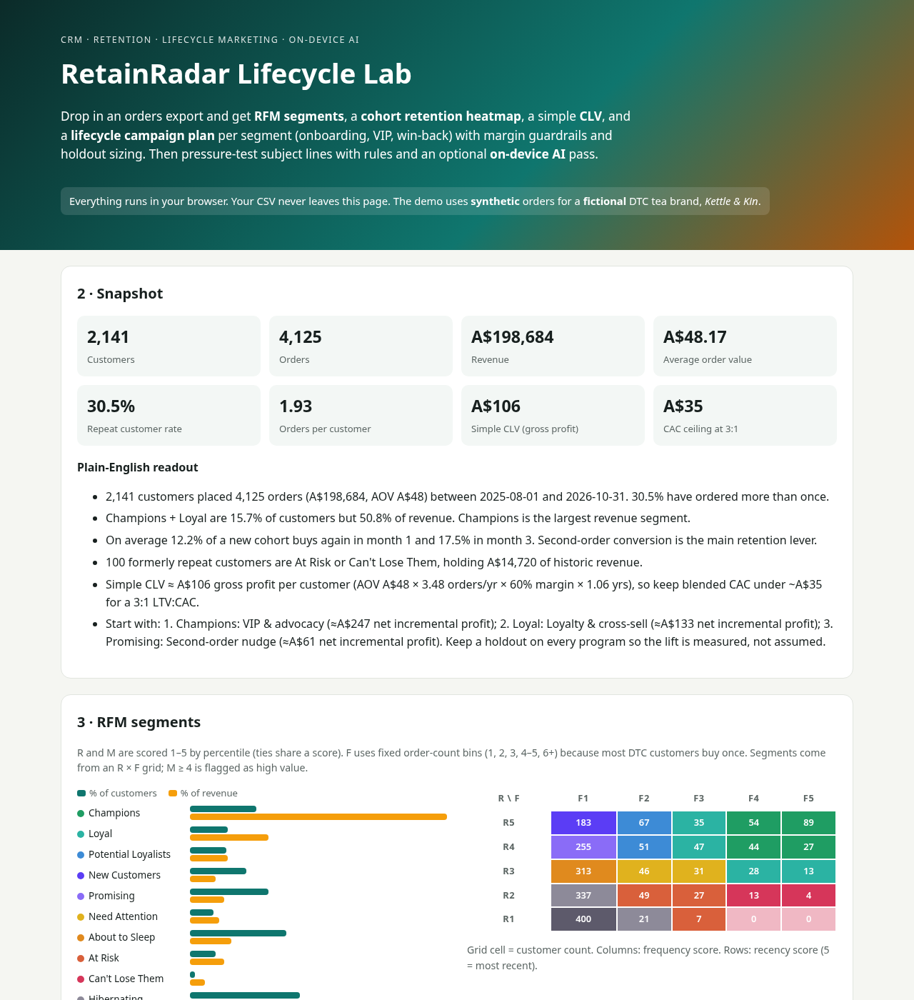

# RetainRadar Lifecycle Lab

**An in-browser CRM and lifecycle marketing tool.** Drop in an orders CSV and it builds **RFM customer segments**, a **monthly cohort retention heatmap** and a **simple CLV with a CAC ceiling**. It then writes a **lifecycle campaign plan** for each segment (onboarding, VIP, win-back and more) with margin-safe offers and holdout sizing, and runs a **subject-line lab** with rule-based scoring plus an optional **on-device AI** pass (a Hugging Face model via transformers.js).

🔗 **Live demo:** https://yashsarkar1806-creator.github.io/retainradar-lifecycle-lab/?demo=1



> The demo uses **synthetic** orders for a **fictional** DTC loose-leaf tea brand, *Kettle & Kin*. It doesn't describe any real company, customer or campaign. Base rates and lifts in the planner are **planning assumptions** to validate with a holdout, not benchmarks.

## Why it matters for marketers

For most DTC brands, about half of first-time buyers never order again, while a small group of repeat customers drives a big share of revenue. Retention and CRM teams have to answer a few questions every month:

- **Who** are our best, slipping and lost customers, and how many of each do we have?
- **How fast** do new cohorts come back, and is that getting better?
- **What is a customer worth**, and so how much can we afford to pay to acquire one?
- **What should we send to each group**, when, with what offer, and how do we prove it worked?

RetainRadar answers all four on one page, in the browser, from a plain orders export (Shopify, WooCommerce, a POS, or a spreadsheet).

## Marketing skills shown

- **CRM segmentation:** RFM scoring, segment design, and sizing the value at risk
- **Retention analytics:** cohort retention curves, repeat rate and inter-purchase timing
- **Unit economics:** CLV, LTV:CAC and a CAC ceiling for paid acquisition
- **Lifecycle strategy:** a program per segment (welcome, habit-builder, VIP, win-back, sunset), trigger timing based on real purchase gaps, and channel mix
- **Margin discipline:** a discount guardrail, the cost of discounting customers who'd buy anyway, and no-discount VIP plays
- **Experimentation:** holdout groups, sample size and minimum detectable effect (MDE) per program
- **Email copy craft:** subject-line pretesting (length, personalisation, spam triggers, segment-angle fit)
- **Applied AI:** on-device zero-shot classification to check and rank copy, with a rule-based fallback

## Features

| Area | What it does |
|---|---|
| **Data in** | Upload or paste a CSV, or load the demo. It auto-detects customer, order, date and value columns, groups line items into orders, excludes refunds, and handles YYYY-MM-DD, DD/MM/YYYY and MM/DD/YYYY dates. |
| **Snapshot and readout** | Customers, orders, revenue, AOV, repeat rate, CLV and CAC ceiling, plus a plain-English readout for stakeholders. |
| **RFM segments** | R and M are scored by percentile (ties share a score). F uses DTC-friendly order-count bins. An R × F grid maps customers to 11 segments (Champions → Lost), with a high-value flag, an R×F heatmap, customer vs revenue share bars, a forward 12-month value per segment, a drill-down and CSV export. |
| **Cohort retention** | Monthly first-order cohorts × months since first order, shown as a heatmap with partial cohorts marked and a size-weighted average curve. |
| **CLV** | AOV × orders per year × margin × lifespan, where lifespan comes from churn measured over a configurable window (or overridden). Also shows the max CAC at 3:1 and the median and p75 days between orders. |
| **Lifecycle planner** | One program per segment with its goal, KPI, timing (driven by the median purchase gap), channel and offer. Offers are capped by a min-margin guardrail. Programs are ranked by net incremental gross profit (incremental orders × AOV × (margin − discount), minus the discount given to baseline buyers, minus send cost). Each one shows its holdout size, the MDE and the sample needed. Exports to Markdown. |
| **Subject-line lab** | 0–100 rule score covering mobile length, personalisation, numbers, caps and "!!!", spam phrases, emoji, segment-angle fit, and a warning for discount-led lines sent to Champions or Loyal customers. It can also suggest segment-fit template lines. |
| **On-device AI** | [transformers.js](https://huggingface.co/docs/transformers.js) runs [Xenova/mobilebert-uncased-mnli](https://huggingface.co/Xenova/mobilebert-uncased-mnli) in the browser. **AI angle check** labels each line's message angle with zero-shot classification and flags lines where the AI and the rules disagree (often a mixed message). **AI pick best ideas** ranks a 21-line idea bank by fit to the chosen segment and blends the result with the rule score (75% rules, 25% AI). If the model can't load, the tool falls back to rule-based templates. No data leaves the browser. |

## How to use

1. Open the [live demo](https://yashsarkar1806-creator.github.io/retainradar-lifecycle-lab/?demo=1), or click **Load Kettle & Kin demo**.
2. To use your own data, upload a CSV with one row per order (or per line item) that has a customer ID, an order date and an order value. Check the detected columns, then click **Analyse orders**.
3. Set your gross margin, churn window, max discount, margin floor, holdout % and send cost. Everything recalculates as you change them.
4. Work through the segments, cohorts, CLV and the ranked lifecycle plan, then download the customer list, a segment list or the plan.
5. In the subject-line lab, pick a segment, paste lines and score them. You can then click **Run AI angle check** or **AI pick best ideas**. The first run downloads about 25 MB of model files, which the browser caches.

To try it on real public data, the [UCI Online Retail dataset](https://archive.ics.uci.edu/dataset/352/online+retail) (CC BY 4.0) works once it's saved as CSV with a `Revenue = Quantity × UnitPrice` column added. Its US-style dates are detected automatically.

Run locally:

```bash
git clone https://github.com/yashsarkar1806-creator/retainradar-lifecycle-lab
cd retainradar-lifecycle-lab
python3 -m http.server 8000   # then open http://localhost:8000/?demo=1
```

## Tech

- Static HTML, CSS and vanilla JS with no build step, hosted on GitHub Pages
- `lib/engine.js` is a dependency-free core (CSV parsing, RFM, cohorts, CLV, power analysis, planner, copy scoring and the synthetic data generator) that runs in both the browser and Node
- `app.js` handles the UI. [transformers.js](https://github.com/huggingface/transformers.js) v3 loads on demand from jsDelivr for ONNX inference in the browser

## Tests

```bash
npm test     # = node --test
```

There are 27 Node tests covering CSV parsing and round-trips, column detection, date formats (including MM/DD detection), line-item aggregation and refund handling, tie-safe quintile scores, F bins, the full R×F segment grid, RFM metrics, purchase gaps, segment shares, cohort retention maths, CLV, normal quantiles and sample size versus textbook values, MDE, the planner's margin guardrail, ranking and testability, angle detection, segment-aware subject scoring, AI-fit blending, demo determinism, and the end-to-end readout and exports.

## Data and licence notes

- Demo data is **synthetic**, created by a seeded generator in `lib/engine.js` for the fictional brand *Kettle & Kin*. Download it from the app with **Download demo CSV**.
- Segment "stay-active" probabilities, base response rates and lifts are illustrative planning assumptions. Replace them with your own holdout results.
- The Hugging Face model downloads at runtime and keeps its own licence (see the [model card](https://huggingface.co/Xenova/mobilebert-uncased-mnli)). The optional public dataset is [UCI Online Retail](https://archive.ics.uci.edu/dataset/352/online+retail) (CC BY 4.0) and isn't bundled here.
- Code: [MIT](LICENSE) © 2026 Yash Sarkar.
